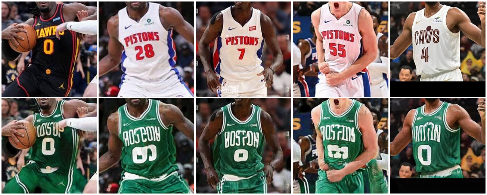
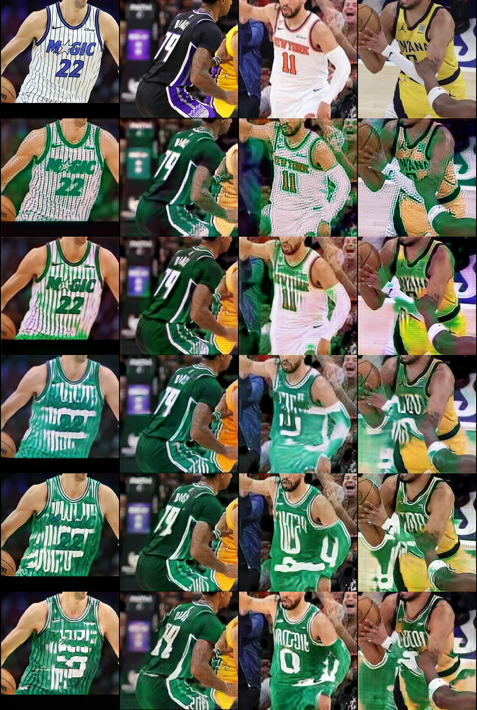
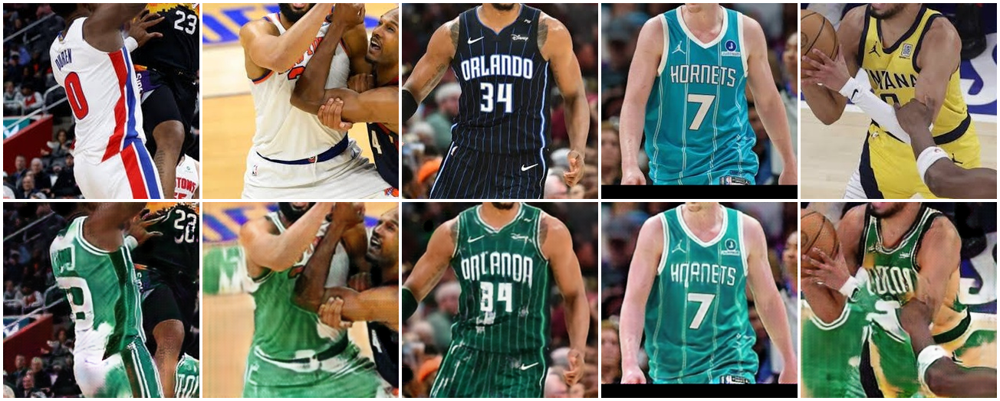

# Celtics CycleGAN: Turning Any NBA Jersey Green

A CycleGAN model implemented in PyTorch that takes a photo of an NBA player in any team's jersey and translates it into a Boston Celtics green road jersey, trained on unpaired images. 

*Top: original. Bottom: generated Celtics jersey. These are the best results.*

Built as a learning project.

---

## Overview

The goal was to learn unpaired image-to-image translation by implementing CycleGAN (Zhu et al., 2017) myself rather than running an existing implementation.

**Why CycleGAN instead of Pix2pix:** Pix2pix needs *paired* training images (the same photo in both the original and the Celtics jersey), which don't exist. CycleGAN learns from two unpaired collections, one of players in other teams' jerseys (domain A) and one of players in Celtics jerseys (domain B), using a cycle-consistency loss to keep the player, pose and background intact.

All model code was written in PyTorch. The official [pytorch-CycleGAN-and-pix2pix](https://github.com/junyanz/pytorch-CycleGAN-and-pix2pix) repository was used only as a reference for architecture details and default hyperparameters. Claude was used to explain relevant concepts and to review or write parts of the code.

## Data pipeline

1. **Collection:** bulk-downloaded game photos from image search with targeted queries. Domain A mixes many teams and jersey colors; domain B is limited to the green road jersey (no white or alternate Celtics jerseys).
2. **Torso cropping with YOLO pose:** a pretrained Ultralytics YOLO11 pose model detects the largest person in each photo and returns body keypoints. The shoulder and hip keypoints define a square crop around the torso, resized to 256×256. Photos without clearly visible shoulders and hips are skipped automatically.
3. **Filtering:** I tested CLIP zero-shot classification to filter out non-Celtics crops automatically. Its scores were poorly separated (the "green Celtics" and "white Celtics" prompts overlapped), so the final filtering was a manual review of the crops.
4. **Split:** 90/10 train/test with a fixed random seed.

| Domain | After YOLO cropping | Train | Test |
| --- | --- | --- | --- |
| A (other teams) | 1,378 | 1,241 | 137 |
| B (Celtics green) | 429 | 387 | 42 |

## Model

| Component | Details |
| --- | --- |
| Generator (×2) | ResNet-based: 7×7 conv → 2 stride-2 downsampling convs → 9 residual blocks → 2 transposed-conv upsampling layers → 7×7 conv + tanh. ~11.4M parameters. |
| Discriminator (×2) | 70×70 PatchGAN: outputs a 30×30 grid of real/fake scores, each judging one image patch. ~2.76M parameters. |
| Normalization | Instance normalization, reflection padding |
| Adversarial loss | Least-squares (LSGAN / MSE) |
| Cycle loss | L1, λ = 10 in each direction |
| Identity loss | L1, weight 0.5 × λ |
| Image buffer | 50 past fakes, sampled 50% of the time when training the discriminators |
| Optimizer | Adam, lr = 0.0002, β = (0.5, 0.999) |
| Schedule | 25 epochs constant lr + 25 epochs linear decay to 0 |
| Augmentation | Resize to 286, random crop to 256, random horizontal flip |

## Training

- **Hardware:** Google Colab, NVIDIA T4 GPU
- **Time:** about 15 minutes per epoch at 256×256; trained across several sessions using full checkpoints saved to Google Drive
- **Debugging:** a short 128×128, 6-block run was used first to verify the pipeline end to end

The same four held-out test players, saved at the end of every epoch:

*Epochs 1, 5, 15, 25, and 50.*

## Results

I evaluated the final generator on 50 held-out test images (one, a coach, was a data-cleaning error and is excluded) and rated each result by hand:

| Rating | Count | Share |
| --- | --- | --- |
| Good: clearly a green Celtics-style jersey, player and background intact | 20 | ~41% |
| Partial: green, but leftover patterns or only partly converted | 16 | ~33% |
| Failed: barely changed, or heavy color bleeding | 13 | ~27% |

Even the "good" results usually have jumbled lettering and numbers, though in the correct position. Two or three (from Detroit Pistons jerseys) came out with near-perfect lettering.

*Most Prominent Failures (from left to right): Too many plaers in frame; Jersey occlusions causing segmentation; Orlando Magic pinstripes; Charlotte Hornets blue; Color bleeding.*

## Failure analysis

**Pinstripes always survive (Orlando Magic).** The cycle loss requires the reverse generator to rebuild the original image from the fake, so the forward generator has an incentive to *hide* information about the original inside its output. With the cycle loss weighted 10× the adversarial loss, keeping faint stripes (small adversarial penalty, easy reconstruction) beats removing them (large cycle penalty). This matches the known tendency of CycleGAN to embed near-invisible information in its outputs (Chu et al., 2017). The same effect explains why reconstructions can recover the original jersey number even when the fake shows a different one.

**Brightness is preserved.** Black jerseys become very dark green rather than the bright Celtics green. The generator changes hue more readily than lightness, again consistent with keeping the image easy to reconstruct.

**Some colors barely change.** Charlotte Hornets light blue was the hardest case, along with both Magic jerseys (white pinstripes and black).

**Occlusions split the jersey.** When an arm or the ball cuts across the jersey, the separated region is often left almost unchanged.

**Numbers collapse to "0".** Single-digit numbers are almost always rendered as "0", most likely because a large share of the Celtics training photos show Jayson Tatum (#0). This is a dataset bias the generator absorbed.

**Lettering is garbled.** GANs at this scale are known to not reproduce text reliably.

## Repository contents

| File | Description |
| --- | --- |
| `cycleGAN_celtics.ipynb` | Full notebook: data prep, model, training, evaluation |
| `images/` | Result figures used in this README |
| `requirements.txt` | Python dependencies |

## References

- Zhu, Park, Isola, Efros. *Unpaired Image-to-Image Translation using Cycle-Consistent Adversarial Networks.* ICCV 2017.
- Chu, Zhmoginov, Sandler. *CycleGAN, a Master of Steganography.* NIPS 2017 Workshop.
- Radford et al. *Learning Transferable Visual Models From Natural Language Supervision* (CLIP). ICML 2021.
- [Ultralytics YOLO](https://github.com/ultralytics/ultralytics)
- [pytorch-CycleGAN-and-pix2pix](https://github.com/junyanz/pytorch-CycleGAN-and-pix2pix) (reference implementation)
